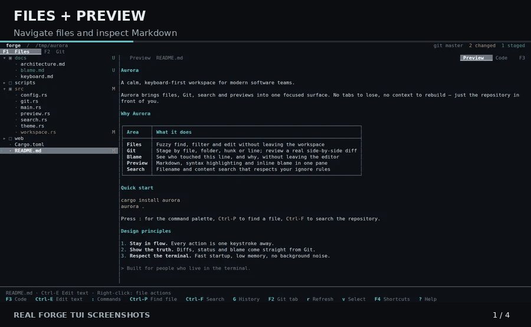
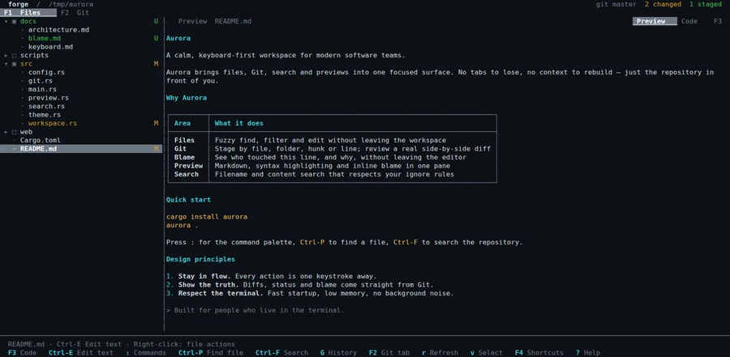
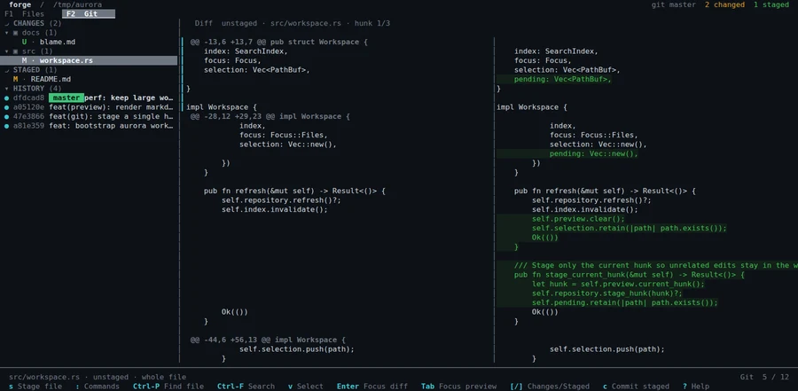
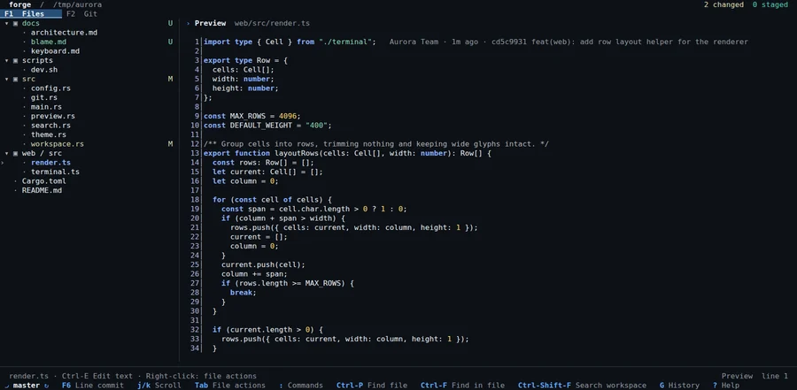
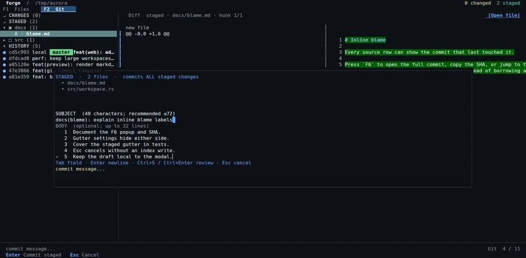

# Forge

**A modern terminal workspace for files, code, and Git.**

Forge is a keyboard-first TUI file manager and Git workspace built in Rust. Browse files, preview and edit code, review full-file diffs, stage changes, and manage branches, history, and stashes without switching between tools.

[Website](https://creature-studio.github.io/forge/) · [Download](https://github.com/creature-studio/forge/releases/latest) · [中文介绍](https://creature-studio.github.io/forge/) · [Issues](https://github.com/creature-studio/forge/issues)



*Tour assembled from screenshots of the real Forge TUI; not a simulated terminal session. [View full-resolution screenshots](https://creature-studio.github.io/forge/#features).*

## Why Forge?

When working over SSH, in tmux, or in a local terminal, switching between a file manager, editor, and Git client interrupts your flow. Forge keeps your files and Git changes in one workspace.

- **Files + Git, together.** Browse a tree with Git status, then switch to changes and staged files in the same app.
- **Review before you commit.** Side-by-side diffs, full-file context, hunk/line staging, commit history and blame.
- **Stay in the terminal.** Built-in syntax-highlighted previews, Markdown preview, search, lightweight editing, and keyboard shortcuts.
- **Manage the complete Git loop.** Stage/unstage, commit, push/pull, branches, stash, and worktrees.
- **Make it yours.** Themes, color-depth options, customizable shortcuts, and Unicode/ASCII/Nerd Font icon modes.

Forge is intentionally **both** a file workspace and a Git interface. Tools such as lazygit focus on Git; ranger/lf/nnn focus on files. Forge's goal is to connect those everyday workflows, not replace your favorite editor or the Git CLI.

## Install

**Linux** (x86_64 / aarch64, glibc) and **macOS** (Intel / Apple Silicon) have prebuilt releases. No Rust toolchain is needed.

```sh
curl -fsSL https://creature-studio.github.io/forge/install.sh | sh
```

The installer downloads the appropriate [GitHub Release](https://github.com/creature-studio/forge/releases/latest), verifies its SHA-256 checksum, and installs into `~/.local/bin` by default. Review the [install script](install.sh) before running it, or [download a release manually](https://github.com/creature-studio/forge/releases/latest).

```sh
cd /path/to/your/project
forge
```

Make sure `~/.local/bin` is on your `PATH`. To check for and install updates:

```sh
forge update --check
forge update
```

Installation options: `FORGE_INSTALL_DIR=/your/bin` changes the destination and `FORGE_VERSION=v0.2.0` pins a release. See the [release and update guide](docs/releasing.md) for details. Windows is not currently included in the prebuilt release matrix; Windows users can use WSL or build from source.

## See it in action

| Files & preview | Git review |
| --- | --- |
|  |  |
| **Themes & code highlighting** | **Commit editor** |
|  |  |

Screenshots were captured from Forge running in a real terminal. For a larger view, visit the [website](https://creature-studio.github.io/forge/).

## Keyboard-first quick start

| Key | Action |
| --- | --- |
| `F1` / `F2` | Files / Git |
| `Ctrl-P` / `Ctrl-F` | Find files / search contents |
| `F3` | Toggle Markdown preview and source |
| `:` / `Ctrl-K` | Command palette |
| `F4` | Shortcut manager |
| `,` | Settings |
| `s` / `u` (Git view) | Stage / unstage |
| `c` (Git view) | Commit dialog |
| `B` / `Z` | Branches / stash |
| `?` | Help |

Mouse support is available, including selection, scrolling, context menus, and copying preview text. Run `forge` from a repository or ordinary directory.

## Build from source

Requires Rust **1.89+** and Git:

```sh
git clone https://github.com/creature-studio/forge.git
cd forge
cargo build --release -p forge
cargo test --workspace
```

The executable is produced at `target/release/forge`.

## Docs & community

- [Detailed usage and developer reference](docs/usage-reference.md)
- [Releases and self-update](docs/releasing.md)
- [Themes](docs/themes.md)
- [Syntax highlighting](docs/syntax-highlighting.md)
- [Report a bug or request a feature](https://github.com/creature-studio/forge/issues)

Forge is open-source under the [MIT license](LICENSE). Contributions and practical feedback are welcome.
