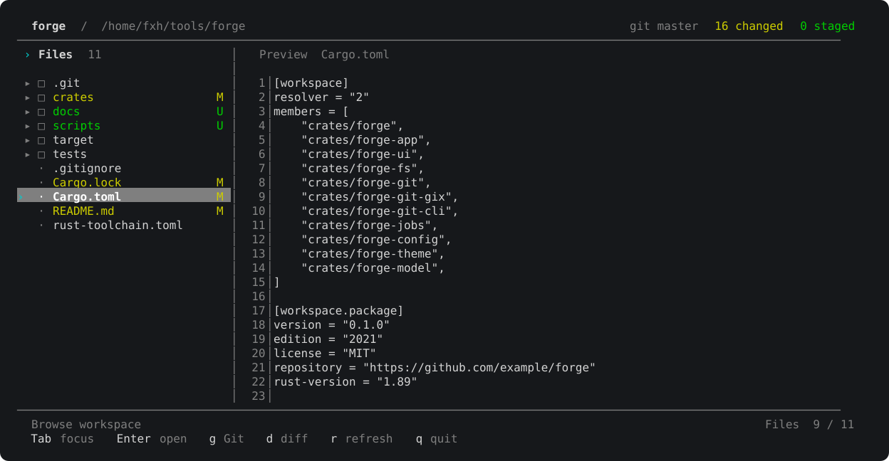

# forge

终端 Git + 文件管理工具，使用 ratatui-kit 组件与响应式状态，gix 读取 Git 数据、git CLI 执行写入。



## 安装

Linux（x86_64 / aarch64）与 macOS（Intel / Apple Silicon）使用 GitHub Release 的预编译包，不需要 Rust 工具链：

```bash
curl -fsSL https://creature-studio.github.io/forge/install.sh | sh
```

安装脚本会下载 `forge-<target>.tar.gz`，用同一版本的 `SHA256SUMS` 校验后安装到 `~/.local/bin`。可用 `FORGE_INSTALL_DIR` 指定目录，用 `FORGE_VERSION=v0.1.0` 固定版本。也可以直接下载 <https://github.com/creature-studio/forge/releases/latest> 里的压缩包自行放置。

## 更新

```bash
forge update --check   # 只查询是否有新版本
forge update           # 下载、校验并替换当前二进制
```

`forge update` 读取 `releases/latest` 的 tag，与编译进二进制的版本号比较，只在新版本可用时替换当前可执行文件。安装在系统目录且没有写权限时会提示重新运行安装脚本。

## 开发与运行

需要 Rust 1.89+、Git。界面依赖固定为 ratatui-kit 0.10.3、Ratatui 0.30.1、Crossterm 0.29.0。

```bash
cargo check --workspace
cargo build -p forge
cargo run -p forge
cargo test --workspace
# 在临时 Git 仓库中验证真实终端交互（Python 3，Linux/macOS）
python3 scripts/smoke-kit.py
python3 scripts/smoke-workspace.py
# Markdown 中文宽字符越界的真实终端回归（需 tmux）
python3 scripts/smoke-markdown-cjk.py
```

Files/Git 侧栏支持目录展开、状态着色和虚拟滚动。右侧提供文件预览、语法高亮与左右 diff。Markdown 文件（`.md` / `.markdown`）默认显示排版预览，可点击内容区顶部的 Preview / Code 或按 `F3` 切换带行号的源码。右侧 Markdown Preview、Markdown Code、普通文本/代码和 Git Diff 都支持按住鼠标左键拖拽选中，放开后按 `Ctrl+C` 复制，`Esc` 清除选区；复制优先使用系统剪贴板，失败时请求终端 OSC 52 剪贴板。Markdown Preview 复制渲染后的可见文字，Code/源码复制保留原始符号和缩进、排除行号栏。支持文件及 hunk 的 stage/unstage、commit、push/pull、右键菜单和鼠标操作。窗口宽度低于 80 列时显示当前焦点面板。

终端 CJK 宽字符换行问题的根因、修复边界与回归方法见 [终端渲染问题记录](docs/terminal-rendering.md)。

## 架构

| Crate | 职责 |
|-------|------|
| `forge` | CLI 入口 |
| `forge-app` | kit 工作区组件、输入分层与业务操作 |
| `forge-ui` | 文件树、Git 树、语法高亮与 diff 原生绘制桥接 |
| `forge-theme` | 原生绘制器的语义色与终端颜色转换 |
| `forge-fs` | 文件系统服务 |
| `forge-git` | Git 门面 |
| `forge-git-gix` | Git 只读后端 |
| `forge-git-cli` | Git 写入及 diff |
| `forge-jobs` | 可取消优先级任务队列与完成通知 |
| `forge-config` | 配置加载 |
| `forge-model` | 共享领域类型 |

kit 接管布局、全屏渲染、事件分发与退出。工作区通过 `use_state` 和 `ContextProvider` 共享状态，按文件浏览、Git、预览和会话拆分；进程级主题使用 `Atom<Palette>`。提交消息草稿只存在于弹窗局部状态，取消后丢弃。后台任务完成或取消时通知组件树，空闲时不定时轮询。弹窗和右键菜单使用独立输入层。

## 颜色与图标

采用轻量终端样式：背景与正文跟随终端，左右面板仅用一条细线分隔，选中行使用中性灰底，青色只标记焦点。侧栏宽度随窗口调整，底部按当前面板显示快捷键；中文长文件名按终端列宽截断。原生内容支持 ANSI16、ANSI256 和真彩，默认 ANSI16。

```bash
cargo run -p forge -- --force-truecolor
cargo run -p forge -- --force-ansi256
cargo run -p forge -- --force-ansi16
cargo run -p forge -- --demo-colors
FORGE_COLOR=256 cargo run -p forge
```

`FORGE_COLOR` 支持 `16`、`256`、`truecolor`。启动时 stderr 显示 palette 与 icons 模式。

默认 builtin Unicode 图标无需 Nerd Font。`FORGE_ICONS=nerd`（或 `1`）启用 Nerd Font 图标；`FORGE_ICONS=ascii`（或 `off`）使用 ASCII。

## 线程与内存

状态、历史和预览都在后台执行，但并发有上限：Tokio 工作线程默认 `min(逻辑核数, 4)`，阻塞池 4 个，gix status 2 个工作线程。文件监听只在 HEAD、packed-refs 或 `refs/` 变化时重载 HISTORY；同一时刻只运行一个 status 任务，运行期间到达的刷新会合并为一次补跑。这样可以避免短生命周期线程各自留下 glibc arena 高水位。可用 `FORGE_WORKERS`、`FORGE_BLOCKING_THREADS`、`FORGE_STATUS_THREADS` 覆盖默认值。

## Git 文件打开与目录 Discard

Git CHANGES / STAGED 中选中文件按 `o`、双击，或右键 **Open file in Files**，会自动展开 Files 中的全部父目录、滚动并选中目标文件，同时显示当前工作区文件。右侧 Diff 标题有可点击的 **[Open file]**，右键同样有 Open file；单击树中文件仍显示 Diff。若文件已在当前检出版本中删除，Forge 明确提示而不创建文件。

Git CHANGES 中的文件或目录、Files 中包含已跟踪未暂存修改的目录，均支持 **Discard changes…**（左侧 `x` 或右键菜单）。按完整目录范围列出即将恢复的文件，必须确认后才执行；仅恢复未暂存的已跟踪文件，**暂存区、未跟踪文件和冲突文件均不受影响**。右键 Discard 始终作用于点击的对象，不会扩大到先前的多选。

## Branches / Worktrees 多级弹窗返回

从 `B`（Branches）或 `W`（Worktrees）列表中打开创建、重命名、切换或删除确认框时，`Esc` 只返回原列表，保留选中条目和滚动位置；再次按 `Esc` 才关闭列表。Branches 中按 `D` 查看分支 Diff 后，`Esc` 也返回分支列表。取消确认不会触发 Git 修改；在列表仍加载时打开输入框再返回，会自动恢复列表读取。

## 文件操作与 Git Worktree 可靠性

文件复制先在目标目录内准备完整临时副本，成功后才发布，不会因读取失败留下空白目标文件；目录复制失败会清理临时目录。FIFO、Socket 等非普通文件默认拒绝复制，避免阻塞。批量 Copy/Move/Delete 失败时报告已完成对象、失败对象和剩余未执行数量；**批量操作不是事务，永久删除不会自动回滚**，Esc 关闭面板也不会中断已经开始的底层 I/O。

Git Worktree 自动刷新支持 .git 指针文件，分别监控私有 HEAD/index 与共享 refs：其他终端切换 linked Worktree 分支后，Forge 底部分支状态会自动更新。文件名与内容搜索明确区分，正则空行命中保留真实行号。实现边界和测试见 docs/file-and-git-reliability.md。

## Stash 全键盘管理

在 Files 或 Git 页面按 `Z` 进入 Stashes，使用 `↑/↓` 或 `j/k` 选择条目：`Enter` 查看选中 Stash 的补丁（`PgUp/PgDn` 滚动，`Esc` 返回列表）；`A` 输入消息并保存当前已跟踪及未跟踪的修改（排除被 Git 忽略的文件）；`a` 应用并保留 Stash；`I` 应用并恢复原暂存状态（stash apply --index）；`p` Pop（成功后移除 Stash，冲突时保留）；`X` 删除 Stash。保存、应用、Pop、删除都需在确认框按 `Enter` 才执行，按 `Esc` 返回上一层而不操作。Stash 列表为空时仍可按 `A` 新建。

Stash 删除是永久丢弃备份记录，不会删除已经应用到工作区的文件。应用若发生冲突将保留 Git 错误，不会把失败伪装成成功。使用原始 Stash 对象 ID 固定选中项，避免其他 Stash 导致序号变化时误操作。可以在命令面板（`:`）搜索 Stashes 打开，Stash 面板标题也显示常用按键。

## 轻量脚本语法高亮

Code Preview 按扩展名支持 Python、Shell、JavaScript、TypeScript、JSON、YAML、SQL，
保留原有 Rust/Markdown 高亮和行号复制。Syntect 只启用必要的纯 Rust 解析
功能，不加载整套默认语法或主题。将 Sublime 的 .sublime-syntax 文件放入
~/.config/forge/syntaxes/（支持 XDG_CONFIG_HOME）即可扩展或覆盖语法，
重启 Forge 生效。遵守现有 64 KiB / 400 行的预览上限。详细说明参见
docs/syntax-highlighting.md。

## 工具面板导航与鼠标操作

工具面板内，方向键选择，PageUp/PageDown 翻动列表，Home/End 定位首尾（输入框中用于文字编辑），Ctrl+PageUp/Ctrl+PageDown 滚动详情。滚轮只滚动鼠标所在的区域；单击选中、双击打开（Git 写入仍需确认）。Esc 返回上一层；在子面板按冒号打开 Commands、按 F4 打开快捷键界面后都能返回。

Branches 默认定位当前分支。Ctrl+P 和 Ctrl+F 重开时保留当前 Worktree 的上次查询，内容搜索还保留正则开关。非 Git 工作区的 Commands 不显示 Git-only 操作；Stash 的 Save/Apply/Restore/Pop/Drop 提示显示在详情区域，避免窄窗口标题截断。详见 docs/tool-panel-navigation.md。

## 文件树、Git 与 History 快捷交互

在 Files/Git 文件/目录列表和 Diff 中按 `Shift+F10`（或 Menu 键）可用键盘打开上下文菜单，`j/k` 或方向键选择、`Enter` 执行、`Esc` 关闭。文件和目录上下文菜单只包含该路径相关操作；Commit、Pull 和 Push 改从 Git 操作快捷键或 `S` 同步面板执行。Branches 中对已检出的当前分支按 `Enter` 不再弹无效确认。

Worktrees 切换回来时恢复该工作区的展开目录、选中文件、滚动位置、过滤条件、Git 展开分组与焦点（仅当前 Forge 运行期间保留）。Git 侧栏 HISTORY 首次读取最近 200 条提交，导航到接近底部后再异步追加 200 条，最多读取 5000 条；已有的 History 工具面板分页继续保留。文件名搜索只显示文件路径，内容搜索则显示实际行号。操作成功和失败通知约 8 秒后消失，底部分支状态保持常驻。

## 底部 Git 分支与同步状态

底部快捷键栏左侧常驻 Git 状态，例如 `⎇ dev ↓0 ↑1 ↻`（落后上游 0 个提交，领先上游 1 个提交）。数值来自本地 `git status --short --branch`，不会自动请求网络 Fetch；已跟踪上游但没有分叉时显示 `↓0 ↑0`，未配置上游或 detached HEAD 时不虚构领先/落后计数，上游分支已删除时提示 upstream gone。

点击这个状态区域仅打开已有的 Remote synchronization 界面；再在界面内按 `F` Fetch、`p` Pull（--ff-only）、`P` Push / Publish Branch。可直接按 `S` 打开同一界面；Git 状态刷新、提交及 Pull/Push 完成后同步状态会自动更新。小终端会优先保留分支和同步入口，再按空间显示计数。状态栏点击本身不会 Push 或 Pull。

**Publish Branch（新分支发布）**：当前分支没有 upstream 时，在 `S` 同步界面按 `P`（或在 Git 侧栏聚焦时直接按 `P`）打开 remote 选择列表；上下键选择目标 remote，`Enter` 查看确认，确认后执行非强制 `git push --set-upstream -- <remote> refs/heads/<branch>:refs/heads/<branch>` 并自动设置跟踪上游。`Esc` 返回列表或取消，不执行写入。已配置 upstream 的分支仍执行普通 Push；远程已有无法快进的提交时不强制覆盖。没有 remote 会显示配置提示，尚无 Commit 时需要先提交。执行前再次验证当前分支、目标 remote 与 tracking 配置；如果中途切换分支，不会推送原选中的分支。

## Settings

主界面 `,` 或命令面板输入 `Settings` 打开独立设置界面。上下键选择、Enter/Space 切换、Esc 退出；包含 Tree Sticky Scroll、Compact Folders、Show hidden files 和进入 F4 快捷键管理。设置写入 `~/.config/forge/config.toml`（如有 XDG_CONFIG_HOME 则使用它），修改时保留其他 TOML 字段。F4 仍单独用于键位绑定。

## 大型工作区加载

Files 首次只读取工作区根目录，目录展开时才异步加载子目录。文件列表采用单个后台文件系统任务读取、分类和排序，避免在成千上万个目录项之间反复切换异步工作线程。Git 状态独立计算，不阻塞根目录显示。

文件系统监听按需注册：只监听工作区根目录、已展开并加载的目录和 Git 元数据，不在启动时递归扫描整个项目（尤其是依赖目录）。这些位置发生外部编辑会自动刷新；尚未展开的深层目录不主动监听，进入该目录时会加载最新内容，必要时可按 `r` 手动刷新整个文件树与 Git 状态。

## 紧凑文件夹（Compact Folders）

Files、Git CHANGES / STAGED 和 HISTORY 默认开启 Compact Folders，连续只有一个子目录的已展开层级压缩为同一行，例如 `frontend / src / views`。遇到分叉、同级文件或尚未展开/加载的目录即停止合并；点击或 Enter 仍操作真实的最深目录，保留完整路径、Git 改动范围与 Diff。窄侧栏会优先保留首尾目录（例如 `zenk-admin / … / system`），不挤掉文件数和状态。

通过 `,` → Settings → Compact Folders 或命令面板搜索 `Compact Folders` 切换。设置保存到 `~/.config/forge/config.toml`（优先 XDG_CONFIG_HOME）：

    compact_folders = true

设为 `false` 可恢复每一级目录独占一行。它独立于 Tree Sticky Scroll，关闭目录合并不影响吸顶功能。

## 树形导航粘性滚动

Files、Git Changes / Staged 以及 History 的树形列表默认启用 **Tree Sticky Scroll**。向下滚动时，滑出顶部的父目录会临时固定在侧栏顶部；吸顶标题使用贯穿侧栏整行的独立主题背景和左侧细色条，区别于普通目录或选中项；最多保留 7 行、且不超过侧栏高度的 40%。点击吸附标题会跳回对应目录，不会展开/收起树或替换右侧预览。

使用 `:` / `Ctrl-K` 打开命令面板，搜索 `sticky`，执行 **View: Tree Sticky Scroll [On/Off] · toggle**。设置立即生效并写入 `~/.config/forge/config.toml`（设置 XDG_CONFIG_HOME 时遵循该位置）：

    tree_sticky_scroll = true

鼠标滚轮只滚动悬停的目录树，不会移动选中文件或修改右侧预览；j/k、上下键仍移动选中项并让它自动进入可见区域。仅当滚动位置位于某个目录的子项内部、且该目录标题已经滑出顶部时才吸附；根目录的文件（如 Cargo.toml）没有可吸附的父目录。

设置为 `false` 可恢复普通滚动。配置重启后保留，不影响真实树结构、Git 操作或原本的“选中目录不更新右侧内容”行为。

## 键位

| Key | Action |
|-----|--------|
| `:` | 搜索命令：文件操作、批量操作和 Git 管理 |
| `Ctrl-P` / `Ctrl-F` | 模糊文件名搜索 / 全局内容搜索；内容搜索内 `Ctrl-R` 切换正则，Enter 跳转 |
| `:` / `Ctrl-K` | 打开命令面板 |
| `,` / `: Settings` | 独立设置界面：粘性滚动、紧凑文件夹、隐藏文件、F4 快捷键管理 |
| `o` / Git 文件双击 | 在 Files 中打开 Git 变更文件（查看当前工作区内容）；Diff 右键可用 Open file |
| `F4` | 快捷键管理；Tab 切换 Files/Git/Editor/Navigation 分组；Enter 重绑，Delete 恢复默认 |
| `F1` / `F2` | 切换 Files / Git；也可点击顶部标签 |
| `F3` | Markdown 文件切换 Preview / Code；也可点击内容区顶部标签 |
| `鼠标拖动 / Ctrl+C` | 右侧预览拖拽选中并复制；支持 Markdown Preview、Code、普通文本、Git Diff，Esc 清除选区 |
| `v` / `V` | 标记当前文件或目录 / 标记所有可见项；Esc 清空。Git 页按行记录路径与 staged/unstaged 侧，同一文件两侧可独立选中 |
| `e` / `E` | 内置文本编辑器 / 使用 `$EDITOR` 打开文件 |
| `F` | 文件过滤：修改、未跟踪、扩展名、隐藏文件、排除目录 |
| `I` | 当前 Diff 的单行操作：选行后 `s/u` 暂存 / 取消暂存 |
| `H` / `L` | 文件历史 / 仓库提交历史；Space 固定版本，`D` 对比，`[/]` 翻页 |
| `G` | 切到 Git 侧栏并展开 HISTORY：lane 图、分支/标签徽标，Enter 展开提交文件树，选中文件在右侧看该提交的 Diff |
| `B` / `Z` / `S` / `W` | 分支 / Stash / 远程同步 / Worktree 管理 |
| `x` / `Delete` | 丢弃所选文件修改（右侧 Diff 为当前 Hunk）/ 删除文件或目录，均需确认 |
| `j` / `↓`、`k` / `↑` | 当前焦点面板移动或滚动 |
| `Enter` / `l` / `→` | 展开目录、打开文件或 diff |
| `h` / `←` / `Backspace` | 上级目录、折叠目录或跳到父级 |
| `Space` | Git 侧栏展开或折叠目录 |
| `Tab` / `Shift-Tab` | 列表与预览之间切换焦点 |
| `g` | 打开 Git 侧栏 |
| `Esc` | 关闭弹窗/菜单，或从 Git 返回 Files |
| `[` / `]` | 跳到 CHANGES / STAGED |
| `s` / `u` | Git 页左侧列表暂存 / 取消暂存选中的文件或整个文件夹（包含子目录）；焦点在右侧 diff 时仅操作当前 hunk。批量时 `s` 只处理已标记的 CHANGES 侧，`u` 只处理 STAGED 侧 |
| `d` | 在 Git 页显示选中文件的 diff |
| `n` / `N` | 焦点在 diff 时跳到下一个 / 上一个 hunk |
| `c` | 打开提交弹窗；Enter 提交，Esc 取消 |
| `p` / `P` | Git 侧栏获得焦点时 pull / push；Files 和右侧 Preview 不触发 |
| `r` | 刷新目录和 Git 状态 |
| `q` | 退出；提交弹窗内 q 为输入字符；Ctrl-C 不直接退出 Forge |
| `?` | 打开操作帮助；帮助内 `Esc` / `?` / `q` 关闭，`j/k`、翻页键或滚轮滚动 |

鼠标支持点选、双击目录、右键菜单和滚轮滚动。提交输入支持光标移动、编辑和中文。

Files 页右键提供 New file、New folder、Rename、Copy、Move 和 Delete。右键文件夹会在该目录内新建，右键文件会在同级目录新建，右键空白区域会在工作区根目录新建。删除文件和文件夹都需确认，文件夹删除包含子目录；右键操作只作用于点击项，批量操作通过 `:` 命令面板执行。

选中文件按 `e` 或右键 Edit text，进入内置多行文本编辑器，支持中文、粘贴、鼠标定位和方向键。`Ctrl-S` 保存，`Ctrl-Z/Y` 撤销/重做；`Esc` 退出，有未保存内容时可 `Ctrl-S` 保存并关闭、`D` 明确放弃，Enter 或 Esc 继续编辑。支持 2 MiB 以内的 UTF-8 文本，保留 LF/CRLF、末尾换行和文件权限；文件被外部修改时拒绝覆盖并保留草稿。`E` 使用 `$EDITOR`（回退到 `$VISUAL`、`vi`），返回后恢复位置。

Stage / Unstage 统一放在 Git 页。底栏和右键菜单随选中项显示 `Stage file`、`Stage folder` 或当前改动块操作。Git 树中选中 CHANGES 的文件夹按 `s`，暂存该目录及所有子目录的改动；选中 STAGED 的文件夹按 `u`，取消暂存。折叠目录也生效，包括新增、修改和删除的文件，不影响目录外的改动。分组标题仅用于导航。取消暂存保留工作区编辑；commit 提交仓库内所有已暂存文件，pull/push 也作用于整个仓库。

Git 的多选标识由仓库内绝对路径和 `staged` / `unstaged` 侧共同组成，因此同一文件在 CHANGES 与 STAGED 的两行可分别选中，标题计数也分别计算。批量 `s` 只处理明确标记的 CHANGES 侧，批量 `u` 只处理明确标记的 STAGED 侧；目录标记递归匹配子项，但不会连带另一侧。Files 页选择仍是纯路径语义；Files 与 Git 切换会清空多选。

Files 过滤器按选中对象的稳定路径恢复选择：过滤后仍可见则保持同一路径和位置；不可见则回退到最近可见父目录，而不是沿用旧列表索引。关闭过滤保留目录展开状态与当前焦点。
