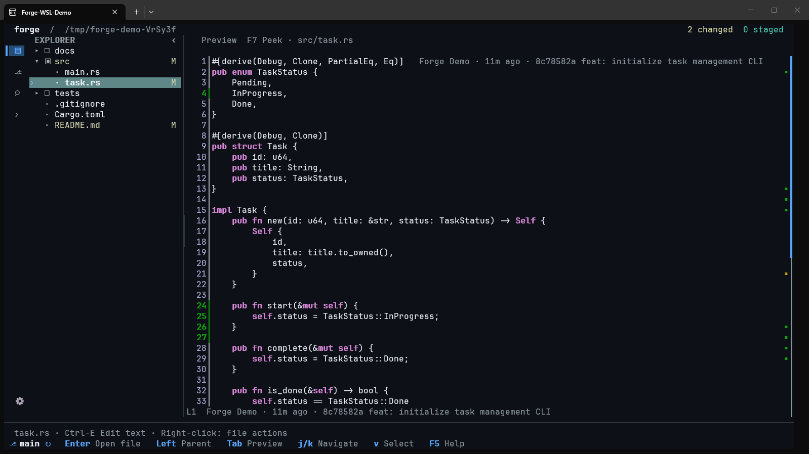
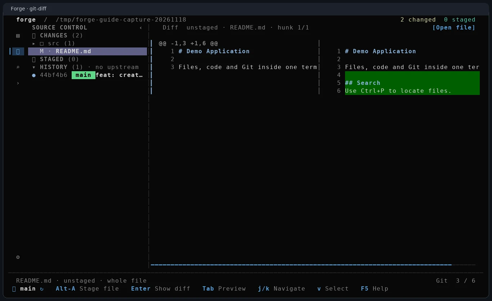
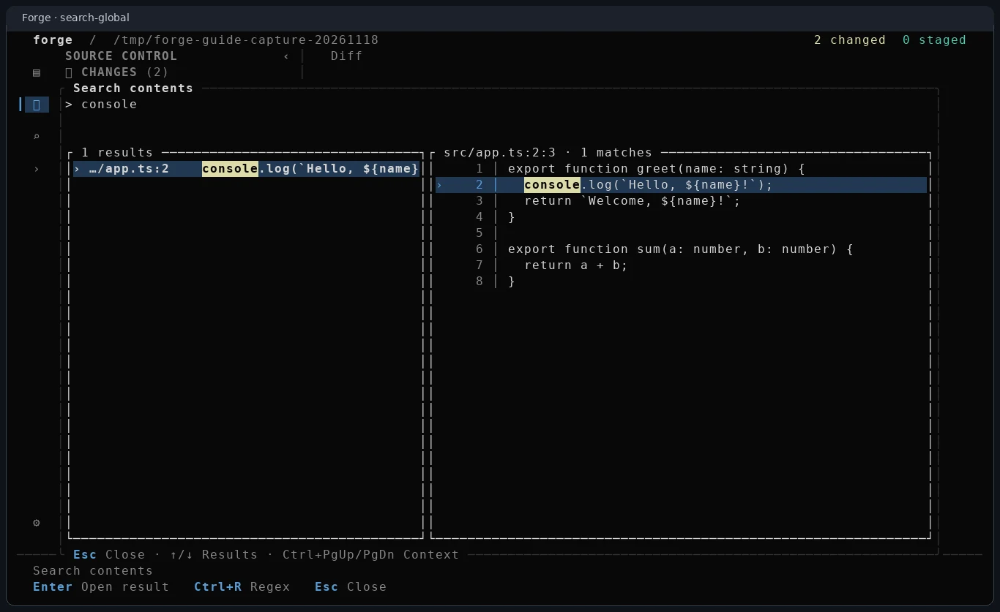
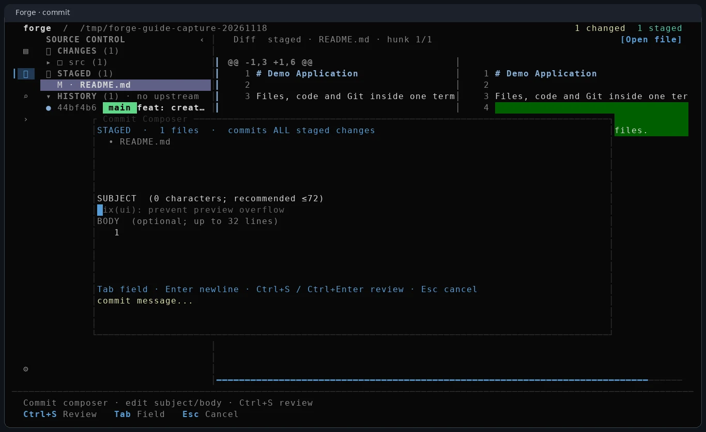
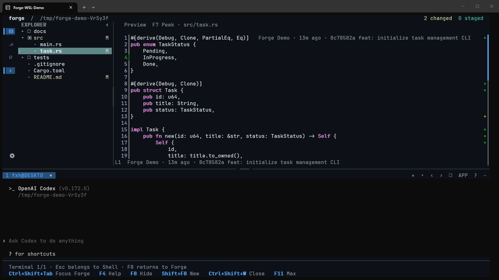
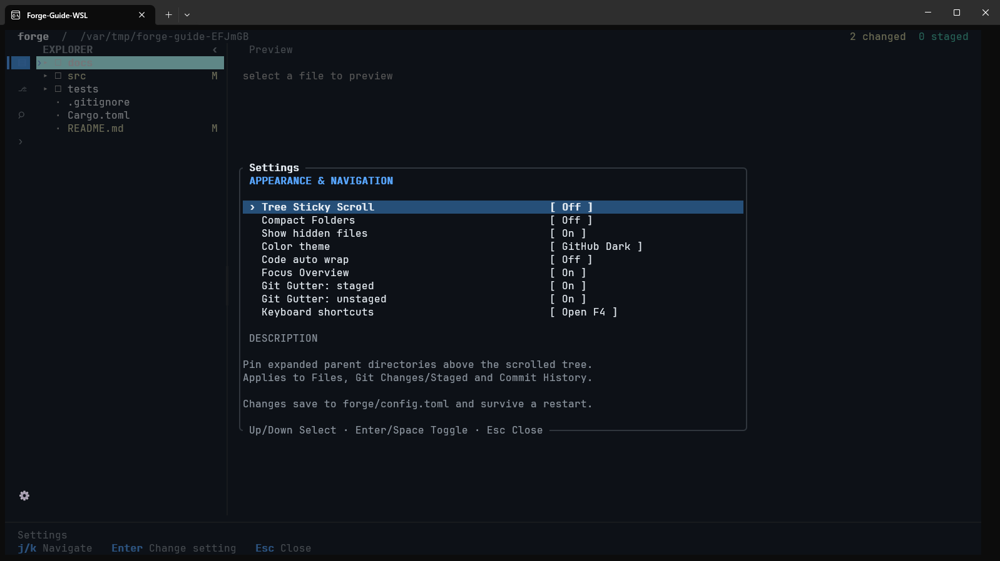

# Forge

**A modern terminal workspace for files, code, and Git.**

Forge is a keyboard-first TUI file manager and Git workspace built in Rust. Browse files, preview and edit code, review full-file diffs, stage changes, and manage branches, history, and stashes without switching between tools.

[Website](https://creature-studio.github.io/forge/) · [Practical guide](https://creature-studio.github.io/forge/en/guide/) · [Download](https://github.com/creature-studio/forge/releases/latest) · [中文介绍](https://creature-studio.github.io/forge/) · [Issues](https://github.com/creature-studio/forge/issues)


*Tour assembled from screenshots of the real Forge TUI; not a simulated terminal session. [View full-resolution screenshots](https://creature-studio.github.io/forge/#features).*

## Why Forge?

When working over SSH, in tmux, or in a local terminal, switching between a file manager, editor, and Git client interrupts your flow. Forge keeps your files and Git changes in one workspace.

- **Files + Git, together.** Browse a tree with Git status, then switch to changes and staged files in the same app.
- **Review before you commit.** Side-by-side diffs, full-file context, hunk/line staging, commit history and blame.
- **Stay in the terminal.** Built-in syntax-highlighted previews, Markdown preview, search, lightweight editing, and keyboard shortcuts.
- **Manage the complete Git loop.** Stage/unstage, commit, push/pull, branches, stash, and worktrees.
- **Make it yours.** Themes, color-depth options, customizable shortcuts, and Unicode/ASCII/Nerd Font icon modes.

Forge is intentionally **both** a file workspace and a Git interface. Tools such as lazygit focus on Git; ranger/lf/nnn focus on files. Forge's goal is to connect those everyday workflows, not replace your favorite editor or the Git CLI.

## Install

**Linux** (x86_64 / aarch64, glibc), **macOS** (Intel / Apple Silicon), and **Windows x64** have prebuilt release targets. A Rust toolchain is not needed once the matching release is published.

```sh
curl -fsSL https://creature-studio.github.io/forge/install.sh | sh
```

**Windows 10/11 x64** (PowerShell or Windows Terminal):

```powershell
irm https://creature-studio.github.io/forge/install.ps1 | iex
```

The Windows installer verifies the ZIP checksum and installs `forge.exe` to `%LOCALAPPDATA%\Programs\Forge\bin`, adding it to your user PATH. Open a new terminal and run `forge` from a project directory. Windows upgrades use the same installer (close Forge before reinstalling); `forge update` remains Linux/macOS-only. Requires Git for Git actions. To inspect the installer, see [install.ps1](install.ps1).

The installer downloads the appropriate [GitHub Release](https://github.com/creature-studio/forge/releases/latest), verifies its SHA-256 checksum, and installs into `~/.local/bin` by default. Review the [install script](install.sh) before running it, or [download a release manually](https://github.com/creature-studio/forge/releases/latest).

```sh
cd /path/to/your/project
forge
```

Make sure `~/.local/bin` is on your `PATH`. To check for and install updates:

```sh
forge update --check
forge update
```

Installation options: `FORGE_INSTALL_DIR=/your/bin` changes the destination and `FORGE_VERSION=v0.3.0` pins a release. See the [release and update guide](docs/releasing.md) for details. Windows x64 releases use a native MSVC ZIP archive; WSL remains an alternative.

## See it in action

Every image below was captured from a **running Forge TUI**, using an isolated demo Git repository. The [illustrated Chinese guide](https://creature-studio.github.io/forge/guide/) now includes 19 updated screenshots and step-by-step workflows.

| Files & source preview | Full Git diff |
| --- | --- |
|  |  |
| **Global content search** | **Commit composer** |
|  |  |
| **Embedded terminal** | **Settings** |
|  |  |

## Key capabilities

- **Files and Git in one workspace:** folder navigation, fuzzy file finding, Markdown/source previews, full-file diffs and staged/unstaged views.
- **Integrated development controls:** lightweight text editor, real Shell tabs with persistent sessions when hidden, in-file and global search.
- **Git review and management:** commit composer, history, blame, source change peek, branches, stashes and worktrees.
- **TUI-first UI:** configurable themes, Focus Overview, scrollbars, collapsible Activity Bar, contextual footer and hover tooltips.

## Keyboard-first quick start

| Key | Action |
| --- | --- |
| `F1` / `F2` | Files / Git |
| `Ctrl+P` | Find files by name |
| `Ctrl+F` (preview focused) | Search inside the current file |
| `Ctrl+K` | Command palette, including global content search |
| `Ctrl+R` | Refresh files and Git status |
| `Alt+R` (content search panel) | Toggle regular expressions |
| `F3` | Toggle Markdown preview and source |
| `F6` / `F7` | Blame details / Git Change Peek (source mode) |
| `Ctrl+E` | Edit selected file |
| `F4` / `F5` | Shortcut manager / Help |
| `F9` | Settings |
| `Alt+A` / `Alt+U` (Git) | Stage / unstage |
| `c` (Git) | Commit composer; `Ctrl+S` reviews the commit |
| `Alt+B` / `Alt+Z` | Branches / Stashes |
| `F8` / `Shift+F8` | Show Terminal / New Shell tab |

The old `?` (Help), `,` (Settings) and single-letter `s/u` (stage/unstage) shortcuts are **not** the current defaults. Always use `F4` to see effective bindings; some keys depend on the focused panel. Mouse support includes hover tooltips, text selection, clickable controls and scrollbars.

## Build from source

Requires Rust **1.89+** and Git:

```sh
git clone https://github.com/creature-studio/forge.git
cd forge
cargo build --release -p forge
cargo test --workspace
```

The executable is produced at `target/release/forge`.

## Docs & community

- [中文操作文档](https://creature-studio.github.io/forge/guide/)
- [发布说明 / Release notes](https://creature-studio.github.io/forge/releases/)
- [Practical guide: file browsing, Git staging, comparison and limits](https://creature-studio.github.io/forge/en/guide/)
- [Detailed usage and developer reference](docs/usage-reference.md)
- [Releases and self-update](docs/releasing.md)
- [Themes](docs/themes.md)
- [Syntax highlighting](docs/syntax-highlighting.md)
- [Report a bug or request a feature](https://github.com/creature-studio/forge/issues)

Forge is open-source under the [MIT license](LICENSE). Contributions and practical feedback are welcome.
